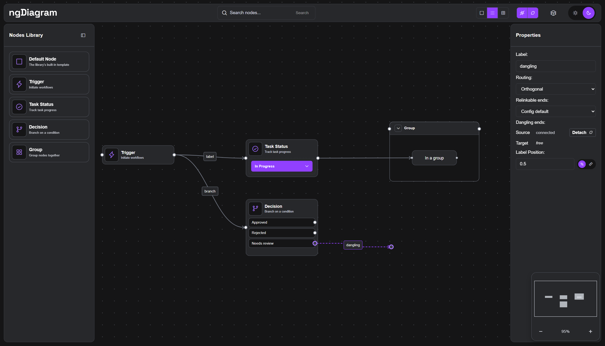

# ngDiagram Feature Demo

[](https://opensource.org/licenses/MIT)

**Live demo:** [synergycodes.github.io/ng-diagram-demo](https://synergycodes.github.io/ng-diagram-demo/)



A showcase of [ngDiagram](https://www.ngdiagram.dev/) — an Angular library for creating interactive diagrams. One app wires up the library's main features side by side: custom node and edge templates, a drag-and-drop palette, grouping with collapsible groups, a clipboard context menu, snapping, rotation, a custom middleware, and edge relinking with dangling edges.

## Project Structure

### 📁 `src/app/diagram/` - **Main ngDiagram Integration**
This directory contains all the core ngDiagram logic and showcases how to use the library. **Start here to learn ngDiagram!**

- **`diagram.component.ts`** - Main diagram component with documentation on:
  - ngDiagram services (ModelService, SelectionService, ViewportService, etc.)
  - Event handling (all diagram events with examples)
  - Configuration setup
  - Model initialization

- **`services/`**
  - `diagram.config.ts` - NgDiagramConfig with snapping, zoom, rotation, etc.
  - `properties-facade.service.ts` - Properties panel integration
  - `debug-events.service.ts` - Complete event handling reference
  - `context-menu-facade.service.ts` - Clipboard and z-order operations
  - `group-collapse.service.ts` - Collapsing and expanding groups

- **`palette/`** - Drag & drop palette system:
  - `palette-data.ts` - Palette item definitions
  - `palette.component.ts` - How ngDiagram drag & drop works
  - Components for palette items and drag previews

- **`node-templates/`** - Custom node components:
  - `trigger-node/` - Basic node with ports, resize, and rotation
  - `custom-node/` - Interactive node with status dropdown
  - `group-node/` - Container node for grouping, collapsible to its header
  - `node-template-map.ts` - Type-to-component mapping

- **`edge-templates/`** - Custom edge components:
  - `custom-edge/` - Edge template with label support

### 📁 `src/app/ui-components/` - **Supporting UI Components**
Angular components that provide the UI around the diagram (navbar, sidebars, properties panel, context menu).

### 📁 `src/app/types.ts` - **Type Definitions**
Shared TypeScript interfaces used across the application.

### 📁 `src/app/diagram/middlewares/` - **Custom Middleware**

- **`horizontal-lock.middleware.ts`** - Demonstrates how to constrain node movement using the middleware pipeline. Nodes with **Lock vertical movement** checked in the properties panel are restricted to X-axis movement only (their Y position stays locked). Select any node, tick the checkbox, and drag it around.

## Edge Relinking and Dangling Edges

Both features are on by default (`linking.defaultRelinkable` and `danglingEdges` in `src/app/diagram/services/diagram.config.ts`). The two toggles next to the background buttons in the navbar switch them off and on, so you can compare them with the default behavior.

- **Relinking** - select an edge and drag the handle at either end onto another port. Drop it back where it was, or press <kbd>Esc</kbd>, to leave the edge unchanged. In the properties panel, **Relinkable ends** overrides the default for the selected edge: both ends, source only, target only, or locked.
- **Dangling edges** - edges with a free end, drawn dashed. You get one when you:
  - drop a new edge or a relink handle on empty canvas,
  - delete a node: its edges stay, anchored where its ports were,
  - click **Detach** next to an end in the properties panel,
  - right-click the canvas and pick **Start edge here**: the edge follows the pointer until you click a port (connects it) or empty canvas (both ends stay free).

Drag the handle at a free end onto a port to connect it again. With debug mode on (the bug button), snackbars report the `edgeDrawEnded`, `edgeRelinkStarted`/`edgeRelinkEnded` and `selectionRemoved` events, including the detached edges.

## Collapsible Groups

Click the arrow in a group's header to collapse it to the header bar, which then shows how many nodes are inside. Edges between the group's nodes and the rest of the diagram stay visible: while the group is collapsed, they connect to the group's own ports. Expanding restores the group's size and the original connections. Nested groups keep their own state, so a group collapsed inside another one is still collapsed after the outer one expands.

A collapsed group can be moved, copied and deleted like any node, but it does not take new members until you expand it. The logic lives in `src/app/diagram/services/group-collapse.service.ts` and follows the library's [expand/collapse groups example](https://www.ngdiagram.dev/docs/examples/expand-collapse-groups): the nodes inside get the `hidden` flag (since 1.4), and the library hides their edges too.

## Getting Started

Built against Angular 21.2 and ngDiagram 1.4 (see `package.json`); Node.js 20.19+ or 22.12+ and npm 10+.

```bash
git clone https://github.com/synergycodes/ng-diagram-demo.git
cd ng-diagram-demo
npm install
npm start
```

Open [http://localhost:4200](http://localhost:4200) — a small diagram loads with every node template: the three custom templates (trigger, task status, decision) and a group whose child is the library's default node. Try dragging new nodes in from the left palette, right-clicking a node for the clipboard context menu, and ticking **Lock vertical movement** on a selected node - a custom middleware then pins its Y position while you drag. Select an edge and drag one of its end handles to relink it, or drop it on empty canvas to leave it dangling. Click the arrow in the group's header to collapse it. `npm run build` compiles to `dist/`.

Working with an AI coding tool? Copy [`mcp.json`](mcp.json) to `.mcp.json` (or your tool's MCP config) to add the ngDiagram docs MCP server — searchable ngDiagram documentation and API reference right in the session. The file carries the Windows command; the macOS/Linux variant is noted inside.

## Support

- **Issues**: [GitHub Issues](https://github.com/synergycodes/ng-diagram-demo/issues)
- **ngDiagram Discussions**: [GitHub Discussions](https://github.com/synergycodes/ng-diagram/discussions), [Discord](https://discord.gg/FDMjRuarFb)
- **ngDiagram Documentation**: [ngdiagram.dev/docs](https://www.ngdiagram.dev/docs)
- **More diagramming resources**: [synergycodes.com/diagramming-resources](https://www.synergycodes.com/diagramming-resources)

## License

MIT — see [LICENSE](LICENSE).

---

Built with ❤️ by the [Synergy Codes](https://www.synergycodes.com/) team
